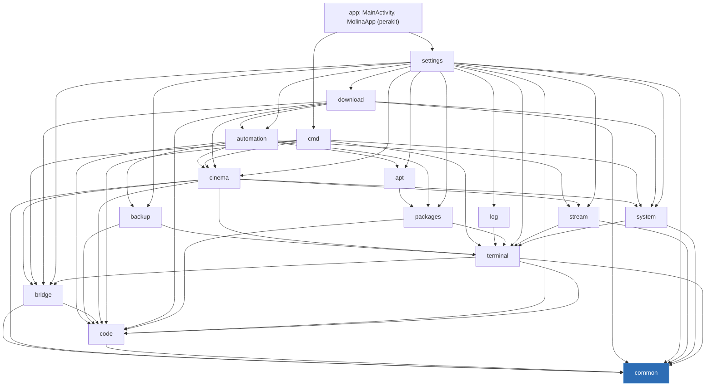

# Arsitektur Molina Studio

Peta ketergantungan antar-paket aplikasi (Molina Terminal dan Molina Cinema). Diagram ini dihasilkan dari kode oleh `scripts/pkg_graph.py --mermaid`, jadi selalu mengikuti kenyataan. Graf bebas siklus: tidak ada paket yang saling bergantung (dijaga CI lewat `--max-cycles 0 --max-cyclic 0`).

